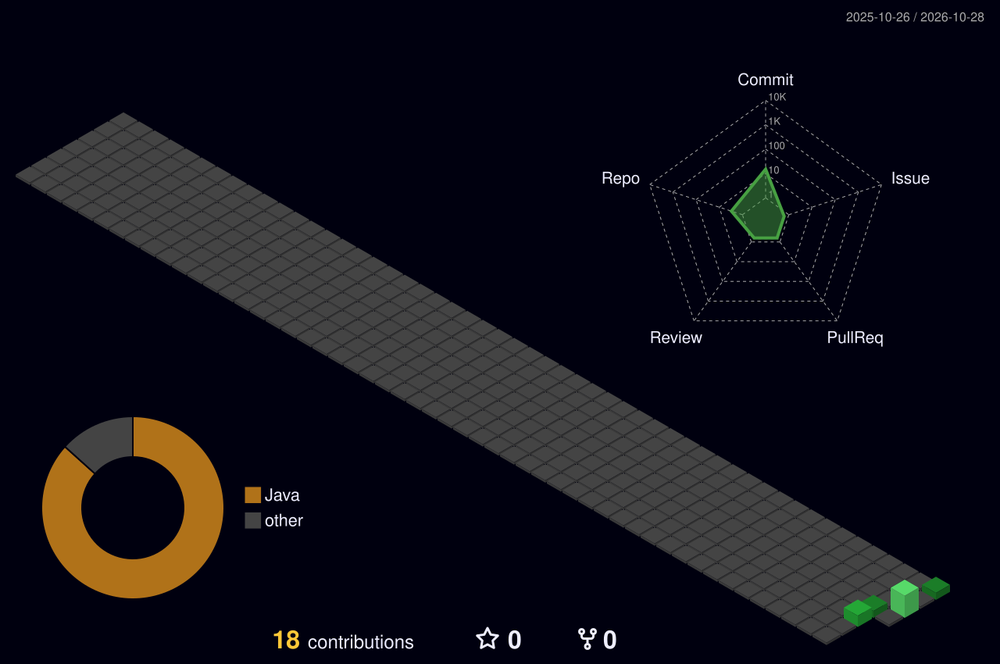

<p align="center">
  


<p align="center">
  <a href="https://github.com/Luciano-alvesjr">
    
  </a>
</p>

---

### `~/sobre-mim`

```bash
luciano@dev:~$ whoami
Luciano Alves — dev em formação, 18 anos, Rio Grande do Sul

luciano@dev:~$ cat foco.txt
> Engenharia de Software (Unilasalle)
> Java + Spring Boot + APIs REST
> Banco de dados (SQL / PostgreSQL)
> Python e fundamentos de cibersegurança

luciano@dev:~$ ./rotina.sh
[ok] estudar
[ok] codar
[ok] commitar     # manter a streak acesa 🔥

luciano@dev:~$ _
```

---

### `~/arsenal`

<p align="center">
  
  
  
  
  
  
  
</p>

---

### `~/projetos`

<table align="center">
  <tr>
    <td>
      <a href="https://github.com/Luciano-alvesjr/fornadaRs-web">
        
      </a>
    </td>
  </tr>
</table>

<p align="center"><sub>Aplicação web integrada a uma API REST (Spring Boot + PostgreSQL) para pedidos online.</sub></p>

---

### `~/contribuicoes-3d`

<p align="center">
  
</p>

---

### `~/stats`

<p align="center">
  
  
</p>

<p align="center">
  
</p>

---

### `~/roadmap`

- [x] Lógica de programação e Python
- [x] Java (fundamentos)
- [ ] APIs REST com Spring Boot
- [ ] Banco de dados a fundo (SQL, modelagem)
- [ ] Redes e Linux
- [ ] Fundamentos de cibersegurança

---

### `~/contato`

<p align="center">
  <a href="https://github.com/Luciano-alvesjr">
    
  </a>
  <a href="https://www.linkedin.com/search/results/people/?keywords=Luciano%20Domingues%20Alves%20Junior">
    
  </a>
  <a href="https://www.instagram.com/lucianodominguesz">
    
  </a>
</p>

<p align="center">
  
</p>
